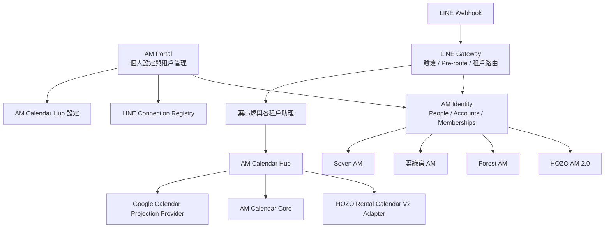
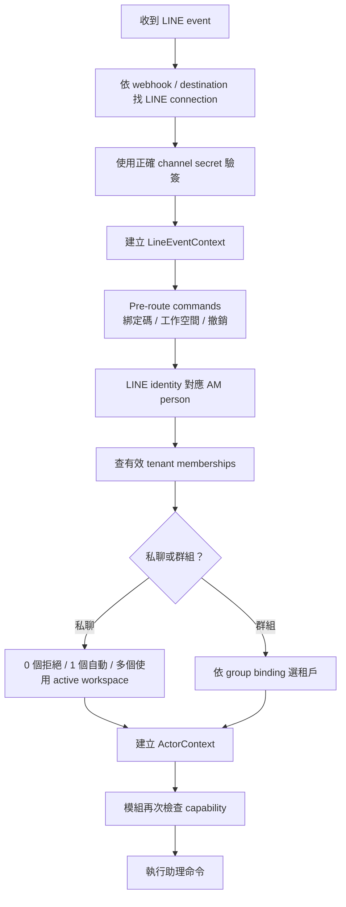

# AM Platform 身分、LINE 與 Calendar 標準化執行交接

| 項目 | 內容 |
| --- | --- |
| 文件日期 | 2026-08-07（Asia/Taipei） |
| 文件狀態 | Ready to Execute |
| 執行模式 | 1 個主控 Session + 最多 3 個並行工作 Agent |
| 主要入口 | AM Portal |
| 第一個導入租戶 | HOZO AM 2.0 |
| 後續租戶 | Forest AM、葉綠宿 AM、Seven AM |
| 名詞修正 | 本案一律使用 AM Platform；先前出現的 IAM 是筆誤 |

## 1. 文件用途

這份文件是新 Codex Session 的正式執行交接檔。

新 Session 收到使用者明確指令「開始」後，應依本文件啟動整體專案，不再只做 HOZO 專用補丁，也不需要為一般技術選擇反覆停下詢問。

本案要把目前 HOZO AM 2.0 已有的 LINE 身分綁定與 Rental Calendar 功能，重新整理成 AM Platform 的通用基礎能力，讓不同 AM 租戶都可以透過 AM Portal 設定自己的：

- 租戶成員與權限。
- LINE 官方帳號或共用 LINE AI 助理連線。
- 個人 LINE 身分綁定。
- LINE 群組路由。
- Calendar backend。
- Google Calendar connection、Calendar target 與 ACL。
- 同步狀態、錯誤與稽核紀錄。

本案的「整體完成」是指共用架構、契約和操作方式一次規劃一致，再以多個可驗證、可回退的版本分階段發布；不是一次把所有租戶無保護地切換。

## 2. 使用者已確認的執行方式

使用者希望開始後持續執行到完成，並採以下原則：

1. 可直接解決的問題由主控與 Agent 自行解決。
2. 暫時無法解決、但不影響其他工作的項目，登記到阻礙清單後繼續往下。
3. 有依賴但可隔離的項目，使用 feature flag、adapter、mock 或相容層隔離後繼續。
4. 所有能完成的工作都完成後，再統一回報剩餘阻礙。
5. 不因程式寫完就宣稱完成；必須有測試、部署與 production proof。
6. 不可為了繼續執行而繞過身分安全、租戶隔離、憑證要求或資料完整性。

使用者說「開始」後，授權範圍包含：

- 建立架構文件、ADR 與 AMCore Upgrade Packages。
- 建立乾淨分支與 worktree。
- 修改本案範圍內的 AM Platform、AM Portal、Rental Adapter 與 Calendar 元件。
- 建立 additive schema 與可回退 migration。
- 執行測試、建立 PR、整合與分階段正式發布。
- 依租戶逐步開啟 feature flags 並執行驗證。

授權不包含：

- 未經確認的正式資料刪除。
- 不可逆或無回退方案的 migration。
- 購買外部服務或產生新的付費承諾。
- 將 production secrets、LINE user ID、Google refresh token 或客戶資料寫入 Git。
- 擴張到本文件範圍以外的系統重建。

## 3. 正確產品定位

### 3.1 AM Portal

AM Portal 是控制入口，負責：

- 個人身分與連線設定。
- 租戶選擇與工作空間切換。
- 租戶成員與角色管理。
- LINE 官方帳號與 AI 助理設定。
- LINE 群組管理。
- Calendar backend 與 Google connection 設定。
- 同步狀態、錯誤修復與稽核查詢。

Portal UI 應使用「LINE 官方帳號與 AI 助理」「我的 LINE 綁定」「LINE 群組管理」等名稱，不使用容易被理解成真人客服的「LINE 聯絡窗口」。

### 3.2 LINE

LINE 是對話與外部身分取得窗口：

- Webhook 先確認 LINE connection，再使用該 connection 的 secret 驗簽。
- 六位綁定碼必須在租戶路由之前處理。
- 私聊依 AM person、tenant membership 與 active workspace 路由。
- 群組依群組綁定路由，不受私人 active workspace 影響。
- 同一套資料模型要支援共用 OA 與租戶專用 OA。

### 3.3 Calendar

AM Calendar Hub 是統一 Calendar 介面：

- HOZO 先透過 Rental Calendar V2 Adapter 接入。
- 新租戶可使用 AM Calendar Core。
- Google Calendar 是單向 projection provider，不是任務或行程資料正本。
- due date 與 planned date 必須分開。
- 個人、公司、團隊 Calendar 的 visibility、action policy 與 ACL 必須分開。

## 4. 目標架構



## 5. 不可違反的架構原則

1. LINE 綁定 AM person，不直接把一個 LINE user ID 永久等同於一個租戶。
2. 使用權來自有效的 tenant membership。
3. 一個 person 可以同時有多個 tenant memberships。
4. LINE external identity 的唯一鍵必須包含 provider 與 connection/channel namespace。
5. 私聊多租戶使用 active workspace；群組使用 group binding。
6. 身分不明、會員停權、租戶衝突或 capability 不足時一律 fail closed。
7. 每個租戶的 Google connection、Calendar targets、ACL、event mappings 與失敗紀錄必須隔離。
8. Google refresh token 只能保存在正式 secret storage，資料庫只存 credential reference。
9. Google Calendar 不得反向變成 AM 任務或 Rental Calendar 的真實資料來源。
10. HOZO 現有 Rental Calendar 不做一次性搬遷；先用 adapter、dual-read 與 reconciliation。
11. 所有新資料表與 migration 優先使用 additive 方式。
12. 所有新功能預設關閉，依平台與租戶 feature flag 開啟。

## 6. 建議資料模型

### 6.1 AM Identity

- `am_people`
- `am_login_accounts`
- `am_tenant_memberships`
- `am_line_connections`
- `am_tenant_line_connections`
- `am_external_identities`
- `am_identity_bindings`
- `am_binding_challenges`
- `am_active_workspaces`
- `am_legacy_identity_refs`
- `am_identity_audit_events`

建議 external identity 唯一鍵：

```text
(provider, connection_id, external_subject_hash)
```

LINE user ID 應以不可逆 hash 支援查詢；如業務確實需要保存原值，另使用加密欄位，且不得出現在一般 log、健康檢查、CI artifact 或 Git。

### 6.2 AM Calendar Hub

- `am_calendar_backend_connections`
- `am_calendar_projection_connections`
- `am_calendar_targets`
- `am_calendar_grants`
- `am_calendar_event_links`
- `am_calendar_outbox`
- `am_calendar_sync_failures`
- `am_calendar_audit_events`

資料必須有清楚的 `tenant_id`。若使用 PostgreSQL，應採 forced RLS；runtime role 不得具有 bypass RLS 權限，平台管理角色另行分離。

## 7. 必須先凍結的共用契約

開始實作前，主控需建立並凍結下列契約：

1. Person、login account、membership、external identity 的 ID 與生命週期。
2. LINE connection 與 external identity 的 namespace 規則。
3. 六位綁定碼的產生、效期、嘗試限制、consume、撤銷與重綁規則。
4. 私聊、群組與 active workspace 的路由規則。
5. `ActorContext` 與 `TenantContext`。
6. Portal session 對應 person 與 membership 的方式。
7. Calendar canonical DTO。
8. Calendar backend adapter interface。
9. Google projection provider interface。
10. 標準錯誤代碼、使用者訊息與 request ID。
11. Idempotency key、event mapping 與 source version 規則。
12. Legacy dual-read、authority cutover、mirror 與 rollback 規則。
13. Secret reference 與 log redaction 規則。
14. API version 與相容期。

建議 `ActorContext` 至少包含：

```text
personId
tenantId
membershipId
lineConnectionId
lineExternalIdentityId
conversationType
capabilities
requestId
routeSource
```

建議標準錯誤代碼：

```text
IDENTITY_NOT_BOUND
MEMBERSHIP_INACTIVE
TENANT_MISMATCH
CAPABILITY_DENIED
ITEM_READ_ONLY
IDEMPOTENCY_CONFLICT
BACKEND_UNAVAILABLE
```

## 8. LINE Webhook 標準流程



六位綁定碼最低安全要求：

- CSPRNG 產生。
- 建議五分鐘有效。
- 資料庫只保存 hash。
- 單次使用。
- 限制錯誤嘗試次數。
- 帳號、IP、LINE identity 分別 rate limit。
- 併發 consume 只能有一個成功。
- Portal session 必須有效且具有目標租戶 membership。
- 已有有效綁定發生衝突時不得靜默轉移。
- 每次發放、consume、失敗、撤銷和重綁都寫 audit event。

## 9. Agent 編制

同時最多使用四個執行槽：一個主控 Session，加三個工作 Agent。三個 Agent 可在不同階段更換任務，但同時不得超過三個。

### 9.1 主控 Session：Control Tower

唯一負責：

- 現況盤點與 ADR。
- 名詞表、架構與契約凍結。
- Upgrade Package 與 migration 編號。
- Agent 工作卡與檔案 ownership。
- 共用熱點整合。
- PR 最終審查。
- integration branch。
- 跨 repository contract tests。
- feature flag 與 authority 切換。
- production deploy、canary 與 rollback 決策。
- production proof 與阻礙總表。

工作 Agent 不得自行合併 main、發布 production 或切換正式 feature flag。

### 9.2 Agent A：AM Identity 與 LINE Core

負責：

- 人員、帳號與租戶成員模型。
- LINE Connection Registry。
- Binding Challenge Service。
- 綁定、撤銷與重綁。
- 私聊 active workspace。
- Webhook 驗簽與 connection routing。
- 身分 API、單元測試與契約測試。

### 9.3 Agent B：AM Portal、Rental Adapter 與 Migration

負責：

- Portal「我的身分與連線」。
- Portal「租戶與連線管理」。
- Portal SSO、role、CSRF 與授權。
- Rental legacy identity inventory。
- Legacy export、backfill、mirror、compare 與 reconciliation 工具。
- Rental endpoint adapter。
- Portal E2E tests。

### 9.4 Agent C：Calendar Hub、Google 與品質安全

負責：

- Calendar backend registry。
- HOZO Rental Calendar V2 Adapter。
- AM Calendar Core。
- Google OAuth 與 managed secondary calendars。
- Calendar ACL、event mapping、outbox、retry 與 idempotency。
- RLS、跨租戶、OAuth、秘密與 audit 測試。
- Production proof scripts 與 rollback drill。

## 10. 檔案 ownership 與整合熱點

以下共用檔案不得讓多個 Agent 同時修改，原則上由主控整合：

- `server.js`
- `core/bootstrap.js`
- `core/router.js`
- `core/direct-line.js`
- `core/modules.js`
- `core/tenants.js`
- `core/access.js`
- 共用 tenant registry
- 共用 Portal access contract
- 共用 migration registry

`rental-management-blueprint/_worker.js` 若仍是 Rental Portal 與 machine API 熱點，只交給 Agent B 修改，其他 Agent 透過凍結契約協作。

Agent A 與 Agent C 如果都需要同一個 AM Platform 熱點，應提交獨立 helper/module 和整合說明，由主控接線，不得彼此覆蓋。

## 11. Repository 與 worktree 規則

### 11.1 開工前硬性 Gate

目前文件治理與實際 production 部署可能存在定位差異：

- AMCore 的 `AGENTS.md` 定義 AMCore 是共用架構、Upgrade Package 與驗證中心，不是 production LINE bot。
- 既有交接資訊顯示 AM Platform Render service 目前可能由 `sevenchen611/AM_Core` 部署。
- 現有 AM Portal 與 Rental binding 功能位於 `rental-management-blueprint`。

主控必須在 M0 建立 ADR，確認：

1. 目前 AM Platform production source of truth。
2. 本案短期是否維持現有 deployment repo。
3. 未來是否另建正式 `AM_Platform` repository。

建議預設：本案先維持現有 production repo，將此狀態記錄為過渡架構；本案完成後再另案拆分，以免同時進行 repo 搬遷和身分平台重建。

### 11.2 工作區規則

- 不在 Google Drive 中 dirty、ahead 或 behind 的 clone 直接開發或發布。
- 從最新 `origin/main` 建立乾淨、非同步雲端路徑的 clone/worktree。
- 一個 Agent、一個工作範圍、一個 worktree、一個 `codex/` 分支。
- 不在 main 直接開發。
- 不使用 `git add -A` 夾帶其他修改。
- migration 編號由主控集中分配。
- 契約 PR 先合併，後續 Agent 再從新的 `origin/main` 建立分支。
- 跨 repo 功能使用版本化 API 契約協調。
- 每個 Agent 完成後回報 commit SHA、測試、風險與回退方式。

目前本交接檔建立時，Google Drive 工作區已有使用者修改：

```text
M docs/HOZO_UNIFIED_CALENDAR_RULES.md
```

新 Session 不得 reset、checkout、覆寫或夾帶這項修改。

## 12. Upgrade Package 規劃

建立一個總計畫，但拆成四個可獨立驗證與回退的套件。實際 `AM-IMP-YYYY.MMDD.NN` 編號由主控依 registry 現況分配。

### Package 1：AM Identity 與 LINE Connection

- Person、account、membership、external identity。
- LINE connections 與 tenant mappings。
- 六位碼、撤銷、重綁與 workspace routing。
- RLS、audit 與安全契約。

### Package 2：AM Portal 身分與連線管理

- 個人身分與連線頁。
- 租戶管理頁。
- LINE OA、群組、Calendar 與 Google 狀態。
- SSO、roles、CSRF、錯誤修復。
- Rental Portal 相容與導向策略。

### Package 3：AM Calendar Hub

- Backend registry。
- Canonical Calendar DTO。
- Rental Calendar V2 Adapter。
- AM Calendar Core。
- Calendar targets、grants 與 mappings。

### Package 4：Google Calendar Projection

- 每租戶 Google connection。
- OAuth、credential reference 與 refresh handling。
- Managed secondary calendars 與 ACL。
- Projection outbox、retry、dedupe 與 failure log。

每個 package 必須包含：

```text
README.md
upgrade.json
INSTALL.md
VERIFY.md
ROLLBACK.md
config / schema / contract
dry-run 或 verification scripts
```

依 `AGENTS.md` 執行：

```text
node tools/check-upgrade-package.js <PACKAGE_ID>
node tools/audit-alignment.js
node tools/compare-project-manifests.js
```

若 audit script 仍硬編碼不存在的 `D:\Codex_project\...` 路徑，先把它列為 tooling blocker，完成可攜式修正或提供可重現替代證據；不得靜默略過。

## 13. 里程碑與驗收 Gate

| 里程碑 | 工作內容 | 通過條件 |
| --- | --- | --- |
| M0 現況盤點與 ADR | Repo 正本、Portal 所有權、LINE OA 模式、既有資料與 secrets reference | ADR 核准；API、schema、tenant、deploy path 清單完成 |
| M1 契約凍結 | Identity、LINE、Portal、Calendar、Google、RLS 與錯誤契約 | 契約文件與 contract tests 可執行 |
| M2 Identity 基礎 | Additive schema、RLS、binding service、audit、flags | Flags 全關時既有行為不變；跨租戶測試通過 |
| M3 Portal 與 LINE | 個人／管理頁、六位碼、pre-route、workspace | 測試環境 Portal → LINE 一次綁定成功 |
| M4 Legacy 遷移 | Backfill、dual-read、compare、mirror、reconciliation | HOZO 舊新身分差異為零或每筆差異均有處理狀態 |
| M5 Calendar Hub | Backend registry、Rental Adapter、AM Calendar Core | 同一契約操作 HOZO 與一個非 HOZO 測試租戶 |
| M6 Google Projection | OAuth、secondary calendars、ACL、outbox | 重送不重複；撤銷停止同步；跨租戶拒絕 |
| M7 HOZO Canary | Seven 既有綁定與一位新成員 | 舊使用者不中斷；新使用者一次自助成功 |
| M8 Forest／葉綠宿 | 各自 tenant、membership、Calendar、Google | 各租戶隔離並完成獨立 production proof |
| M9 Seven AM | 正式 tenant onboarding 與 adapter 決策 | Identity、LINE、Calendar、Google 全部獨立驗證 |
| M10 Legacy 退場 | Rental 舊入口轉址／唯讀、fallback 關閉 | 完整觀察期無 legacy 依賴；rollback drill 完成 |

## 14. AM Portal 資訊架構

### 14.1 個人區

- 我的 AM 身分。
- 我的 LINE 綁定。
- 產生六位綁定碼。
- 撤銷與重新綁定。
- 我的租戶。
- 目前工作空間與切換。
- 我的 Calendar 與 Google 狀態。

### 14.2 平台／租戶管理區

- 租戶基本設定。
- 成員與角色。
- LINE 官方帳號與 AI 助理。
- 共用／專用 OA 模式。
- Webhook URL 與健康狀態。
- Rich Menu 版本與狀態。
- LINE 群組管理。
- Calendar backend。
- Google connection、Calendar targets 與 ACL。
- 同步錯誤、重試與稽核。

### 14.3 建議角色

- Platform Owner
- Tenant Admin
- Identity Admin
- Calendar Admin
- Group Admin
- Member
- Auditor

Portal 不顯示 channel secret、access token、Google refresh token 或完整外部 subject。錯誤畫面應提供 request ID、Webhook 是否收到、目前 build marker 與可執行的修復步驟，避免使用者反覆盲目重試。

## 15. Feature Flags

新能力預設關閉，支援平台總開關與每租戶開關：

```text
amIdentity.enabled
amIdentity.authority = legacy | compare | am
amIdentity.bindingIssueEnabled
amIdentity.bindingConsumeEnabled
amIdentity.legacyMirrorEnabled

lineConnections.enabled
personalAssistant.workspaceSelectionEnabled

calendarHub.enabled
calendarHub.backend
calendarHub.legacyFallbackEnabled

googleCalendar.connectionEnabled
googleCalendar.projectionEnabled
googleCalendar.companyCalendarsEnabled
googleCalendar.personalCalendarsEnabled

personalAssistant.proactivePushEnabled
```

開啟順序：

1. Schema 與新程式上線，flags 全關。
2. 開 compare read，只記錄差異。
3. 開單一 canary user。
4. 開 HOZO 小範圍。
5. 開 HOZO 全租戶。
6. Forest。
7. 葉綠宿。
8. Seven AM。
9. Google projection 永遠晚於 Identity 與 Calendar Core。

緊急關閉順序：

1. 關閉 proactive push。
2. 關閉 Google projection。
3. 暫停新綁定碼發放與 consume。
4. Identity authority 從 `am` 降為 `compare` 或 `legacy`。
5. 隱藏 Portal 新入口。
6. 保留 schema、audit、bindings 和 event mappings，不刪資料。

## 16. Legacy 遷移策略

### 階段 1：Legacy 仍是權威

- 盤點既有 Rental identity。
- 建立 legacy refs。
- Backfill person、membership、external identity 與 binding。
- 所有寫入使用 idempotency key。
- 報告只保留 hash、數量與差異，不放明文 LINE user ID。

### 階段 2：Compare Read

每次 resolve 同時查 Rental legacy 與 AM Identity；使用者結果仍取 legacy，但記錄：

- match
- missing
- conflict
- revoked mismatch
- tenant mismatch

差異未處理完，不切換 authority。

### 階段 3：AM 成為寫入權威

- 新綁定只寫 AM Identity。
- Rental endpoint 改為 adapter 呼叫 AM API。
- 若仍需 legacy mirror，使用 outbox、冪等與 audit。
- Legacy 資料不得反向覆蓋 AM。

### 階段 4：關閉 Fallback

- Mirror lag 為零。
- 完成 reconciliation。
- 關閉 legacy fallback。
- 舊資料唯讀保留，不刪除 binding、revocation 或 audit history。

若 mirror lag 不為零，不得直接回切 legacy；應先暫停新綁定和相關寫入，完成 reconciliation 後再決定回退。

## 17. Google Calendar 原則

每個租戶分別設定：

- Google connection。
- Credential reference。
- Managed secondary calendars。
- Calendar targets。
- ACL。
- Event mapping。
- Outbox、retry 與 failure log。

OAuth 最低要求：

- `state` 綁定 Portal session、tenant 與 nonce。
- 建議使用 PKCE。
- Redirect URI 精確 allowlist。
- 使用最低必要 scope。
- Refresh token 只進 secret storage。
- 每租戶 credential reference 隔離。
- 預設不寫使用者 Gmail primary calendar。
- Google ACL 不得放寬 AM 內部授權。

投影要求：

- Stable event mapping。
- Idempotent upsert/cancel。
- Retry 不產生重複事件。
- 401、403、429、5xx、timeout 與 token revoke 都有 failure record。
- Projection 失敗不阻止 AM/Rental source record 建立或更新。

## 18. 必測情境

### 18.1 Identity 與 LINE

- 綁定碼成功、錯誤、過期、重播與併發。
- 已綁 LINE、已綁 Portal、衝突與撤銷後重綁。
- 一人多租戶。
- 一租戶多 LINE OA。
- 不同 OA 的 LINE user ID namespace。
- 無租戶資格拒絕。
- 停權後立即拒絕。
- 私聊 active workspace 切換。
- 群組 route 不受私人 workspace 影響。
- Webhook 使用錯誤 secret 時拒絕。
- 同一 LINE event 重送不重複執行。

### 18.2 Calendar 與 Google

- 私人與公司 item 的 action policy。
- Due date 與 planned date。
- All-day 與 timed event，時區 `Asia/Taipei`。
- Create、update、move、cancel。
- Google retry 不產生重複 event。
- Google token 失效與重新授權。
- Quota、429、5xx、timeout、410 sync token。
- OAuth callback tenant mismatch。
- 撤銷後停止私人投影。
- Calendar backend 故障時不跨租戶 fallback。

### 18.3 租戶與遷移

- RLS 無 tenant context 時拒絕。
- 跨租戶讀寫拒絕。
- Backfill 重跑不重複。
- Dual-read 差異報告正確。
- Legacy mirror outbox 冪等。
- Rollback 後新綁定不遺失。
- HOZO Rich Menu 現有功能回歸：我的今日、我的行事曆、新增待辦、昨日未完成、我要請款、身份設定。

## 19. Production Proof Bundle

每個租戶至少保存：

- GitHub PR。
- Main commit SHA。
- CI run。
- Render／Cloudflare deploy ID。
- `/health` build marker。
- Schema／migration version。
- 遮蔽後的 feature flag snapshot。
- Portal 授權成功與未授權拒絕。
- 六位碼發放、成功 consume 與重播拒絕。
- 「我的今天」只讀取目前租戶。
- 建立一筆 Calendar item。
- Google event mapping 一對一。
- 相同要求重送沒有重複 event。
- 跨租戶讀寫拒絕。
- 撤銷後私人資料拒絕。
- Rollback drill。
- Git、CI artifact 與 log 沒有 secret 或個資。

只有 production proof 完成後，該租戶的 manifest 才可標為 `Deployed`。

## 20. 租戶 Rollout 順序

### 20.1 HOZO AM 2.0

先做，因為已有正式 LINE binding、Rental Adapter 與既有使用者。

Canary 至少包含：

- Seven 現有綁定不中斷。
- 一位從未綁定的新成員。
- Portal 到 LINE 一次自助綁定成功。
- 撤銷與重新綁定。
- 我的今天、我的行事曆與新增待辦。
- Rental 與 Google projection。
- Legacy compare 差異為零或均已處理。

### 20.2 Forest AM

若目前仍是 shadow 或 `authorizationReady=false`，先完成正式 tenant membership、管理者與 authorization gate，再開 Identity 與 Calendar。不得因 Calendar 測試成功就把全部任務功能一起視為正式啟用。

### 20.3 葉綠宿 AM

使用獨立 tenant ID、Google connection、Calendar、ACL、Portal membership 與 production proof。可在 HOZO 穩定後與 Forest 平行準備，但正式 flag 分開開啟。

### 20.4 Seven AM

先確認或建立 AM Platform 正式 tenant，不得直接假設既有獨立 SevenAM project 就是平台 tenant。需要先完成 tenant registry、UUID、membership、RLS、LINE connection mode、Google connection，以及舊 SevenAM 身分／資料的 adapter 或遷移決策。

## 21. 阻礙管理方式

主控建立持續更新的 Blocker Ledger，每筆至少包含：

```text
blocker_id
發現時間
所屬里程碑
受影響租戶／元件
問題描述
已嘗試方法
是否阻擋其他工作
隔離或替代方案
需要的權限／決策／外部狀態
下一次處理條件
目前狀態
```

阻礙分類：

### B1：局部阻礙

只影響單一畫面、租戶或 provider。登記後使用 flag 關閉該局部能力，繼續其他工作。

### B2：依賴阻礙

影響後續某一條工作流。先完成 interface、mock、adapter、測試與其他獨立部分；被依賴的正式啟用保持關閉。

### B3：安全／權限／不可逆阻礙

例如缺 production secret、OAuth consent、正式管理員、資料衝突、無法回退 migration。不得繞過；保留現況、完成其他可做工作，最後集中向使用者說明。

同一阻礙不得因為困難就把整個專案標為完成，也不得讓所有無關工作一起停止。

## 22. 每張 Agent 工作卡格式

主控每次委派前必須寫明：

```text
Agent 名稱
目標
Repository
Branch
Worktree
允許修改檔案
禁止修改檔案
輸入契約版本
輸出物
測試命令
回退方式
是否需要 production／database／OAuth 權限
```

Agent 完成時必須回報：

```text
完成內容
未完成內容
修改檔案
API／schema 變更
測試結果
未解風險
需要主控整合的熱點
回退方式
Commit SHA
```

## 23. 主控整合節奏

1. 契約 PR 先合併。
2. 工作 Agent 從最新 main 建立功能分支。
3. 各功能 PR 獨立審查。
4. 主控建立短生命週期 integration branch。
5. 整合已核准的 PR。
6. 執行跨 repo contract tests。
7. 執行完整 regression、安全測試與 migration dry run。
8. 合併 main。
9. 部署程式但維持新 flags 關閉。
10. 執行 health、build marker 與 production proof。
11. 開單一 canary。
12. 觀察無誤後才開下一個租戶。

同一時間不得讓 Agent 修改已進入 integration freeze 的熱點。

## 24. 建議預設決策

若現況盤點沒有發現相反限制，主控可採用以下預設，不需要先停下詢問：

1. 正式 Portal 長期使用 `am.hozorental.com/portal`；目前 `rental.hozorental.com/portal` 在相容期保留並逐步轉址。
2. 初期延用共用 LINE OA，但資料模型同時支援租戶專用 OA。
3. Identity 與 Calendar 的租戶資料使用 PostgreSQL forced RLS。
4. 每個租戶使用獨立 Google connection 或至少獨立 credential reference、Calendar targets 與 ACL。
5. HOZO 使用 Rental Calendar Adapter；新租戶優先使用 AM Calendar Core。
6. 本案期間不先搬 production repository；先用 ADR 記錄過渡狀態，repo 拆分另案處理。
7. 六位碼保留為永久 fallback；LIFF 可在核心穩定後作第二階段體驗改善。

如果任何預設會造成不可逆資料變更、外部付費或明顯擴大使用者原始範圍，必須停下該項並列入 B3，而不是自行決定。

## 25. Definition of Done

整體標準化只有在以下條件全部成立時才完成：

1. AM Portal 是身分、LINE 與 Calendar connection 的統一入口。
2. 有效租戶成員可以自行完成 LINE 綁定，不需要工程師修改資料。
3. 同一 person 可以安全屬於多個租戶。
4. 私聊可以切換 active workspace。
5. 群組仍依 group binding 路由。
6. 每個租戶可使用共用或專用 LINE OA。
7. 每個租戶具有獨立 Calendar backend 設定。
8. 每個租戶具有隔離的 Google connection、Calendar targets 與 ACL。
9. HOZO 既有使用者不需要重新綁定。
10. Rental legacy endpoint 只作 adapter，不再是長期身分正本。
11. Google Calendar 維持 projection，不是 source of truth。
12. RLS 與應用層都能阻止跨租戶存取。
13. 所有新能力都能透過 feature flag 關閉。
14. Rollback 不刪資料，也不遺失新綁定。
15. HOZO、Forest、葉綠宿與 Seven 分別完成 production proof。
16. 四個 Upgrade Packages、租戶 manifests、安裝、驗證與回退文件完整。
17. Rich Menu 既有六項功能完成回歸測試。
18. 最終報告清楚分成「已完成並發布」「已完成但未啟用」「仍有阻礙」。

## 26. 既有參考文件

新 Session 開始前依序閱讀：

1. `AGENTS.md`
2. `docs/AM_PLATFORM_IDENTITY_LINE_CALENDAR_STANDARDIZATION_EXECUTION_HANDOFF_2026-08-07.md`
3. `docs/HOZO_CALENDAR_PASSDOWN_2026-08-07.md`
4. `docs/HOZO_UNIFIED_CALENDAR_RULES.md`
5. `docs/AM_PORTAL_統一帳號整合方案.md`
6. `docs/PLATFORM_CONNECTION_IDENTITIES.md`
7. 各租戶 `docs/tenants/*/project-improvement-manifest.md`

部分舊文件可能有編碼顯示問題；讀取時使用正確 UTF-8／原始檔案編碼，不得因終端亂碼而猜測或覆寫內容。

既有 production URL、repository、merge commit、Render deploy 與 API 狀態，以 `docs/HOZO_CALENDAR_PASSDOWN_2026-08-07.md` 為線索，但新 Session 必須在 M0 以 GitHub、Render、Cloudflare、health endpoint 與實際程式碼重新驗證，不得直接把舊交接狀態當成當下事實。

## 27. 新 Session 的啟動指令

使用者在新 Session 可直接貼上：

```text
請先完整閱讀：
1. AGENTS.md
2. docs/AM_PLATFORM_IDENTITY_LINE_CALENDAR_STANDARDIZATION_EXECUTION_HANDOFF_2026-08-07.md

然後開始執行 AM Platform 身分、LINE 與 Calendar 標準化專案。

請使用一個主控 Session 加最多三個工作 Agent，先完成 M0 現況盤點與 ADR，再依文件持續執行到所有可完成項目都完成。一般技術問題請自行處理；局部阻礙登記到 Blocker Ledger 後繼續其他工作。不要碰或覆寫工作區中原有的未提交修改，不要把 secrets 或個資寫入 Git。

請依 HOZO AM 2.0、Forest AM、葉綠宿 AM、Seven AM 的順序 rollout。每個租戶必須有測試、回退方法與 production proof，不能因程式寫完就標示完成。

開始。
```

## 28. 開始後的第一批動作

新 Session 收到「開始」後立即執行：

1. 讀完必要文件與 `AGENTS.md`。
2. 唯讀盤點 Git 狀態、branches、remotes、production source、部署服務與現有 API。
3. 建立 M0 ADR 與 Repo/Service/Secret-Reference Inventory。
4. 建立 Blocker Ledger。
5. 建立主控工作計畫和第一輪三張 Agent 工作卡。
6. 凍結 Identity、LINE、ActorContext、Calendar DTO、Provider 與 Migration 契約。
7. 分配 Upgrade Package 編號。
8. 從乾淨 `origin/main` 建立非 Google Drive worktrees。
9. 進入 M2 additive schema 與 flags-off 實作。

不要把「再規劃一次」當作第一個成果；本文件已是核准的執行基線。M0 的目的在於驗證實際狀態與凍結契約，完成後應直接進入實作。
